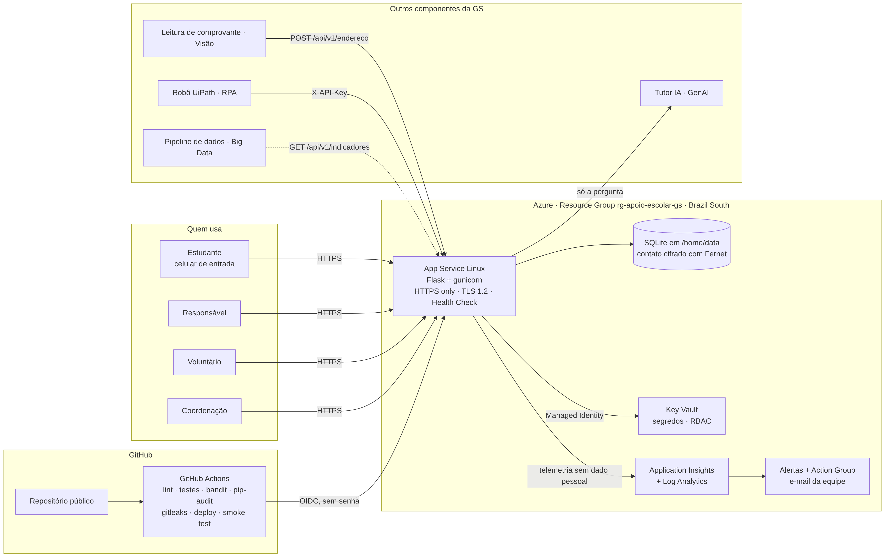

# Arquitetura

Fonte do diagrama: [arquitetura.mmd](arquitetura.mmd) (Mermaid).

## Decisões e justificativas

| Decisão | Por quê | O que abrimos mão |
|---|---|---|
| **Azure App Service Linux (PaaS)** | É o serviço visto no semestre; entrega HTTPS, TLS, Health Check e identidade gerenciada sem administrar servidor. | Menos controle que VM ou contêiner; suficiente para o MVP. |
| **Região Brazil South** | Dados de crianças e adolescentes ficam no Brasil e a latência é menor para o usuário. | Preço um pouco maior que regiões dos EUA. |
| **HTML renderizado no servidor, sem framework de front-end** | Páginas de poucos kB funcionam em celular de entrada e conexão ruim; sem fontes nem scripts de terceiros. | Menos interatividade. |
| **SQLite em `/home/data`** | Custo zero e nenhuma credencial de banco para proteger; `/home` é armazenamento persistente do App Service. | Uma instância só (1 worker). O acesso usa SQLAlchemy, então migrar para Azure Database for PostgreSQL é trocar `DATABASE_URL`. |
| **Key Vault + Managed Identity** | Nenhum segredo no código, no repositório ou no pipeline; a aplicação recebe só permissão de leitura do cofre. | Um recurso a mais para criar. |
| **Deploy com OIDC** | O GitHub não guarda senha da Azure; o token vale minutos e só para o environment `production` deste repositório. | Exige criar App Registration; há plano B com publish profile. |
| **Application Insights via OpenTelemetry** | Requisições, falhas, dependências e logs em um lugar, com alertas por e-mail. | Custo se o volume crescer (limitado por teto diário de 1 GB). |

## Fluxo de deploy

1. Commit na `main`.
2. `qualidade`: ruff, pytest (cobertura mínima 80%), bandit, pip-audit. Em paralelo, `segredos`: gitleaks no histórico.
3. `pacote`: grava o hash do commit no arquivo `VERSAO` e gera `release.zip`.
4. `deploy`: login OIDC e publicação no App Service (o Oryx instala as dependências).
5. Smoke test: chama `https://<app>.azurewebsites.net/health` até a resposta trazer `status: ok` **e** a versão do commit. Se não acontecer em 5 minutos, o pipeline falha.

## Resiliência

- O tutor IA é opcional: se estiver fora do ar ou demorar mais de 8 s, a API devolve uma resposta padrão e a página continua útil.
- `/health` testa o banco; o Health Check do App Service usa essa rota e o alerta avisa a equipe.
- Limite de requisições por IP no login, no cadastro e no tutor.
